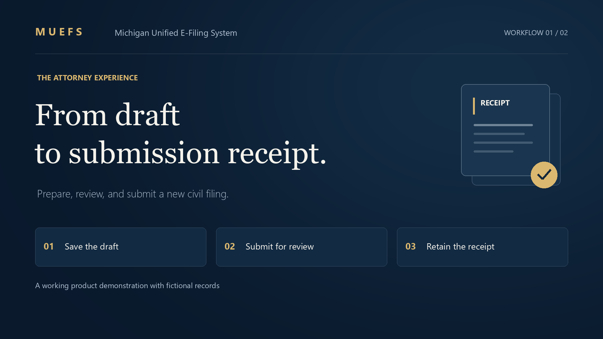
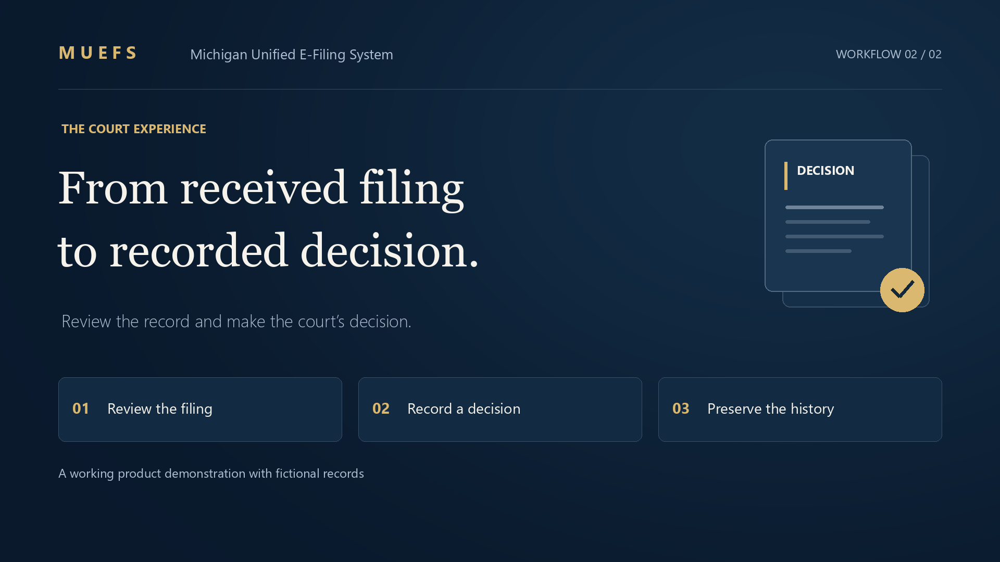

# MUEFS demo videos and recording guide

Show one filing moving from an attorney to a court clerk and into the public
docket, then show self-represented filing and court administration. These are
working application flows with retained records. The payment processor and live
court CMS connection remain stubs; a state could choose and connect those systems
as part of an implementation.

## Finished walkthroughs

| Attorney · 2:16 | Court staff · 2:20 |
| --- | --- |
| [](muefs-attorney-flow.mp4) | [](muefs-court-flow.mp4) |
| [Watch the attorney video](muefs-attorney-flow.mp4) · [Captions](muefs-attorney-flow.srt) | [Watch the court video](muefs-court-flow.mp4) · [Captions](muefs-court-flow.srt) |

Both videos are 1080p MP4s with a synthetic English voiceover, synchronized
on-screen captions, and embedded chapter markers. Separate SRT files provide
editable captions. They follow the same fictional case, **Demo Harbor Services
v. Demo Supply**, through working application flows.

- **Attorney:** sign in, select the court and case type, save a draft, upload the
  complaint and summons, review the filing, record a simulated payment, submit,
  retain the receipt, and find the submission in My Filings.
- **Court staff:** search the assigned court's review queue, inspect the received
  filing, download an original attachment, check the submission and fee record,
  return a separate sample with a correction reason, accept the attorney's
  filing, and inspect its acceptance history and new case docket.

The recordings use fictional documents, a synthetic fee, and an explicitly
fictional court calendar in one isolated demo session. No payment is charged.
The court's live CMS connection remains a stub. Acceptance and public document
publication remain separate actions.

## Prepare a recording

From the repository's `backend` directory, with the dependencies in the
[quick start](../README.md#try-it-now) installed:

```powershell
python run_demo.py
```

Open **http://localhost:3000/login**. The launcher seeds the full demo database,
keeps existing demo records on subsequent starts, enables all five role cards,
and uses simulated payments. External payment recording and outbound email and
service delivery are disabled for this local demonstration.

Use a desktop window around 1440 × 1050 or larger. Switch accounts with **Switch
Role** in the header, keeping the same browser window throughout the recording.
The hosted demo isolates records by visitor: another browser or private window
gets a different sandbox and will not see the filing you just submitted.

The local demo keeps its SQLite database between runs. Use a distinct case title
for each take, and note the filing ID and case number as they appear. The examples
below use the seeded **3rd Circuit Court**, where the demo clerk already has
review access.

Download these searchable, one-page PDFs before recording. Every page is marked
as a fictional demonstration sample; the waiver sample is not an official court
form.

| File | Use |
| --- | --- |
| [Complaint](attachments/complaint-demo.pdf) | Required document for the new civil case |
| [Summons](attachments/summons-demo.pdf) | Companion document for the complaint |
| [Motion](attachments/motion-demo.pdf) | Optional existing-case filing |
| [Supporting brief](attachments/brief-demo.pdf) | Optional companion-upload demonstration |
| [Fee waiver request](attachments/fee-waiver-demo.pdf) | Self-represented filing with a nonpublic waiver attachment |

## Suggested sequence

| Role | What to show | Point to explain |
| --- | --- | --- |
| Attorney | New case, documents, simulated payment, submission receipt | One filing portal across courts |
| Court Clerk | Review and accept that same filing | Court-controlled intake with retained decisions |
| Public docket | Find the accepted case | Public records with separate document-access decisions |
| Self-Represented Litigant | Plain-language guidance and a fee waiver request | A filing path for people without an attorney |
| System Administrator | Grant and revoke access to a court | Account access with reasons and history |

### 1. Attorney: submit a new civil case

1. Choose **Attorney**, then **New Filing**.
2. Search for and select **3rd Circuit Court**. Similar names such as 23rd Circuit
   Court may also appear, so choose the exact court.
3. Choose **Start a new case**, then **Civil - General**.
4. Use a fictional case title such as **Demo Harbor Services v. Demo Supply** and
   a short description. Continue to save the draft and open document upload.
5. Select document type **Complaint**, choose `complaint-demo.pdf`, and click
   **Upload Document**. Repeat with **Summons** and `summons-demo.pdf`.
6. Choose **Review Filing**. Show the itemized demo fee and the notice that no
   card or bank details are collected. The seeded example is **$150**; this is
   demonstration data, not a court-approved fee quote.
7. Click **Record simulated payment — $150.00** (the label reflects the current
   demo amount). No money is charged. The review updates automatically when the
   filing details and documents are unchanged.
8. Click **Submit Filing**, then **View submission receipt**. Show the filing ID,
   submission time, and **Submission received** history entry. **Print this
   page** provides a printable receipt if desired.

Suggested narration: “The filer can prepare the documents, resolve the fee step,
and receive a retained submission receipt. This demonstration simulates payment;
a state's payment provider would handle the actual transaction.”

### 2. Court Clerk: review and accept the filing

1. Choose **Switch Role**, then **Court Clerk**. Open the review queue.
2. Confirm the working court is **3rd Circuit Court**, then open the filing ID
   from the attorney's receipt.
3. Show the uploaded documents and review actions. Click **Accept**.
4. Note the new case number. Acceptance creates the demo case and retains the
   court's decision. **Return for Correction** and **Reject** are available for
   other outcomes.
5. Optionally switch back to **Attorney** and open that filing's history to show
   **Accepted by the court**.

Suggested narration: “Submission and court acceptance are separate events. The
clerk controls intake, and the filer can see the result and its history.”

### 3. Public docket: find the accepted case

1. Choose **Switch Role**, then **Public docket → Browse records**.
2. Search for the new case by its title or case number and open it.
3. Show the case and docket. The public view has no **File with Court** action.

Public docket visibility does not automatically publish every uploaded document.
Filed originals, nonpublic material, and reviewed public copies have separate
access rules. To show a public PDF download, use a seeded case that already has
a published demo copy, such as **Johnson v. Smith Industries LLC**.

### 4. Self-Represented Litigant: request a fee waiver

1. Choose **Switch Role**, then **Self-Represented Litigant → New Filing**.
2. Show that **Plain-language guidance** is enabled. The wizard explains the
   steps as “Pick your court,” “Your case,” and “Upload your papers.”
3. Start another **Civil - General** case in **3rd Circuit Court**, with a title
   such as **Demo Resident v. Demo Rental Company**.
4. Upload the sample **Complaint** and **Summons**, then choose **Review Filing**.
5. Choose **Fee waiver request**, select `fee-waiver-demo.pdf`, and click
   **Attach waiver request to filing**.
6. Click **Refresh Review**, then **Submit Filing**. Show the receipt and the
   waiver's pending review status.

Suggested narration: “A filer can submit a waiver request without paying the
simulated fee first. The attachment is nonpublic, and the request goes to the
court for a decision; submitting it does not grant the waiver.”

### 5. System Administrator: manage court access

1. Choose **Switch Role**, then **System Administrator**. Open **People & court
   access** if it is not already shown.
2. Choose **Manage Robert Johnson**, the seeded clerk account.
3. Select **1st Circuit Court** and **Clerk review**. Enter a reason such as
   “Fictional additional court assignment for the role demonstration.”
4. Click **Grant court role** and show the retained change and reason.
5. To complete the example, enter a reason and **Revoke court role** for that
   additional assignment. The original 3rd Circuit Court assignment remains.

Suggested narration: “Court access is an explicit assignment. Administrators can
change it and retain who made the change and why.”

## Optional: motion companion upload

As **Attorney**, search for party **Smith**, open **Johnson v. Smith Industries
LLC**, and choose **File with Court**. Enter a description, continue, select
**Other Motion**, and upload `motion-demo.pdf`.

Click **Add Brief in Support of Motion** in the companion guidance. This selects
the correct document type and focuses the file picker; choose `brief-demo.pdf`
and upload it. Companion guidance follows the actual uploaded document types.
The optional motion example can end at the saved draft. Use the new-case flow
above to demonstrate an assessed fee and simulated payment.

## Existing video

[`muefs-walkthrough-60s.mp4`](muefs-walkthrough-60s.mp4) is an older attorney-only
preview covering sign-in, case search, and the beginning of a filing. It does not
cover submission, clerk acceptance, waivers, or administration. Use the sequence
above for the current five-role recording.
